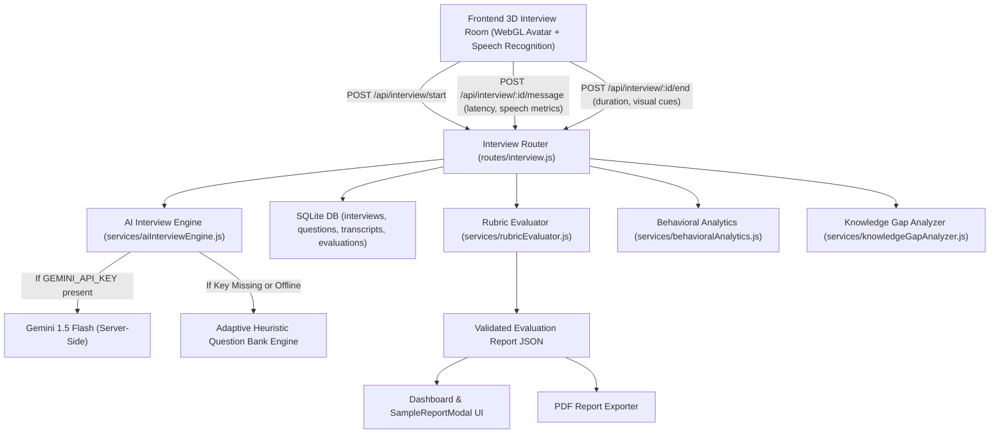

# Intervista — AI Interview Engine & Performance Analytics Architecture

**Module Owner:** AI Conversation & Evaluation Logic  
**Specification:** Task 3 — Real-Time AI Interviewer, Rubric Scoring, Behavioral Analytics & Knowledge Gaps  
**Shared Contract:** `backend/shared/interviewContract.js` & `frontend/utils/interviewContract.js`  
**API Prefix:** `/api/interview`  

---

## 1. Overview & System Topology

The Intervista AI Interview Engine powers conversational real-time mock interviews with adaptive follow-ups, objective speech telemetry, evidence-grounded rubric evaluations, and prioritized knowledge-gap analysis.



---

## 2. Real-Time AI Interviewer & Provider Integration

### Provider Setup (Google Gemini)
1. Add `GEMINI_API_KEY` to `backend/.env`:
   ```bash
   GEMINI_API_KEY=your_gemini_api_key_here
   ```
2. The server initializes a session with the model `gemini-1.5-flash` using conversational prompt constraints:
   - One question at a time.
   - Natural conversational acknowledgment (< 3 sentences).
   - Role-specific probes matching selected difficulty and experience level.
   - Zero markdown bullets in spoken dialogue to ensure lifelike speech synthesis.
3. **Security Commitment:** Permanent API keys are strictly confined to the backend server. The frontend never receives API keys or talks directly to external LLM providers.

### Demo-Mode Fallback & Offline Capabilities
When `GEMINI_API_KEY` is empty, expired, or offline:
- The system automatically engages the **Adaptive Heuristic Question Bank Engine**.
- Curated question banks cover:
  - **Software Engineer / Backend:** Distributed Transactions, Saga Pattern, Database Indexing, Caching, Production Observability.
  - **Frontend Developer:** Core Web Vitals (LCP, INP), Long Tasks, Virtual DOM, State Colocation, WebSocket Throttling.
  - **Data Scientist / ML:** Decision Thresholds, Precision-Recall, Data Drift (PSI), Covariate Shift.
  - **Product Manager:** North Star Metrics, A/B Testing Cannibalization, Cohort Retention.
  - **Behavioral / Leadership:** STAR narrative framework, technical conflict resolution, cross-functional trade-offs.
- **Adaptive Follow-Up Logic:**
  - Evaluates candidate answer depth (word count, keyword presence).
  - If answer is brief (< 30 words), prompts for concrete metrics and architecture.
  - If candidate mentions key architectural elements (e.g., "Redis", "Saga", "Locks"), triggers contextual follow-up probes.
  - Automatically adjusts difficulty between `Medium` and `Hard`.

---

## 3. Interview State & Transcript Contract

The engine enforces a finite state machine defined in `backend/shared/interviewContract.js`:

| State | Trigger / Description |
| :--- | :--- |
| `INTERVIEWER_SPEAKING` | Avatar speech synthesis and mouth articulated animation active. |
| `CANDIDATE_LISTENING` | Question delivered; candidate formulating answer. |
| `CANDIDATE_SPEAKING` | Microphone active; speech-to-text recognition streaming. |
| `AI_PROCESSING` | Server-side dialogue generation or evaluation running. |
| `RECONNECTING` | Transient network reconnect. |
| `COMPLETED` | Interview finalized; validated evaluation report stored. |
| `FAILED` | Unrecoverable error state. |

### Transcript Persistence
Every message exchange is stored in the SQLite database with:
- `sessionId`: Associated interview ID.
- `sender`: `'interviewer'` | `'candidate'`.
- `content`: Full spoken or submitted text.
- `timestamp`: Unix timestamp in milliseconds.
- `latencyMs`: Response-start latency (time elapsed between interviewer speech conclusion and candidate response start).
- `audioDurationMs`: Duration of candidate speech.
- `questionId`: Associated question identifier.

---

## 4. Answer Evaluation & Configurable Rubric

Evaluations are performed by `backend/services/rubricEvaluator.js` using a 6-criterion rubric:

| Criterion | Weight | Definition & Evidence Grounding |
| :--- | :---: | :--- |
| **Correctness & Relevance** | **25%** | Factual accuracy and direct addressal of the core prompt. |
| **Technical Knowledge** | **25%** | Depth of domain primitives, concurrency, and architecture. |
| **Completeness** | **15%** | Coverage of edge cases, failure modes, and scalability. |
| **Answer Structure** | **15%** | STAR framework or top-down architectural decomposition. |
| **Use of Examples** | **10%** | Quantitative metrics (RPS, latency budgets, % scale) and concrete technologies. |
| **Clarity & Conciseness** | **10%** | Pacing, vocabulary precision, and absence of meandering filler. |

### Grounded Evidence Quotes
- The evaluator extracts verbatim sentences from the candidate's transcript messages (`evidenceQuotes`).
- Every rubric criterion includes direct citations of what the candidate actually articulated.
- **Strict Anti-Hallucination Rule:** Does not invent scores for unanswered or unreached questions. If a session is incomplete or abandoned, unanswered questions are marked as `NOT_EVALUATED` and not penalized in composite averages.

---

## 5. Behavioral & Communication Analytics

Implemented in `backend/services/behavioralAnalytics.js`:

1. **Speaking Rate (WPM):**
   - Calculated as `(totalWords / durationMinutes)`.
   - Rated against human conversation benchmarks: `< 110 WPM` (Deliberate/Slow), `125-165 WPM` (Optimal Cadence), `> 170 WPM` (Rapid).
2. **Filler Words Detection:**
   - Detects occurrences of words from `FILLER_LEXICON` (`um`, `uh`, `like`, `you know`, `actually`, `basically`, `sort of`, `kind of`, `i mean`).
   - Computes `fillerRatioPercent = (fillerWords / totalWords) * 100`.
3. **Response-Start Latency:**
   - Measures time between question completion and candidate answer initiation.
4. **Verbal Restarts:**
   - Identifies stuttered repetitions and restarts (`\b([a-zA-Z]{2,})\s+\1\b`).
5. **Ethical Observable Visual Telemetry:**
   - Consent-based client cues: Face visibility %, framing status (`'Centered & Balanced'`), and approximate head orientation (`'Direct Forward Alignment'`).
   - **Ethical & Scientific Boundary:** Strictly forbids claiming to diagnose stress, detect lies, or evaluate psychological confidence/honesty from facial expressions. All observations are strictly neutral and descriptive.

---

## 6. Knowledge Gaps & Personalized Study Plan

Implemented in `backend/services/knowledgeGapAnalyzer.js`:

For every evaluated question, the engine:
1. **Identifies Tested Concepts:** (e.g., `Database Indexing`, `Read Replicas`, `Caching Strategies`).
2. **Identifies Missing Concepts:** Distinguishes concepts demonstrated by the candidate from concepts missed or inadequately explained.
3. **Distinguishes Untested Topics:** Explicitly flags related advanced topics that were not reached during the prompt, ensuring the candidate is not penalized for unasked material.
4. **Assigns Evidence-Based Priority:**
   - `High`: Core competency prerequisites directly impacting the hiring bar.
   - `Medium`: Recommended domain knowledge for the role level.
   - `Low`: Nuanced optimizations or advanced edge cases.
5. **Synthesizes Targeted Study Plan:**
   - **Recommended Literature:** Official manuals, documentation, and foundational engineering chapters.
   - **Hands-on Practice Exercises:** Concrete engineering drills (e.g., EXPLAIN ANALYZE benchmarks, Cache-aside implementations).
   - **Follow-up Interview Drill Questions:** Realistic interview prompts for targeted practice.

---

## 7. API Endpoints

| Method | Path | Description |
| :--- | :--- | :--- |
| `GET` | `/api/interview/schema` | Returns JSON Schema, state machine, and rubric criteria definitions. |
| `POST` | `/api/interview/start` | Creates session, stores first question, returns opening greeting. |
| `POST` | `/api/interview/:id/message` | Records candidate transcript, generates dynamic adaptive follow-up. |
| `POST` | `/api/interview/:id/end` | Concludes session, computes rubric evaluation, saves report to DB. |
| `GET` | `/api/interview/sessions` | Retrieves past interview history with scores for current user/guest. |
| `GET` | `/api/interview/report/:id` | Returns saved evaluation report by session ID. |

---

## 8. Automated Test Suite

Run the automated test suite from `backend/`:
```bash
npm test
```

### Verified Test Cases:
1. **Missing Credentials Test:** Verifies graceful fallback to demo mode without crashing or hanging when API keys are absent.
2. **Invalid Output Schema Test:** Rejects reports missing mandatory fields, scores out of range, or ungrounded evidence.
3. **Incomplete Transcripts Test:** Verifies zero-candidate-message sessions evaluate cleanly without dividing by zero or hallucinating unasked scores.
4. **Behavioral Analytics Test:** Verifies filler detection, WPM cadence, and non-diagnostic visual observations.
5. **Knowledge Gaps & Study Plan Test:** Verifies concept stem matching, priority assignment, and hands-on drill generation.
